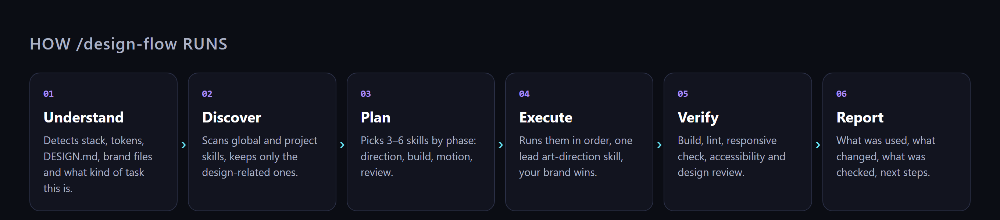
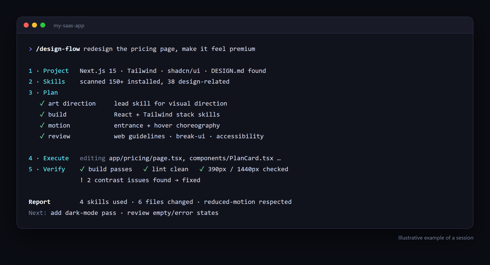

<p align="center">
  
</p>

<p align="center">
  <a href="LICENSE"></a>
  
  
  
</p>

**design-flow** is a single slash command for [Claude Code](https://claude.com/claude-code) that turns "make this look great" into a structured, repeatable design pass.

Instead of remembering which of your many design skills to call, and in which order, you describe the goal once. design-flow looks at your project, discovers every design-related skill you have installed, picks the right handful, runs them in a sensible order, and verifies the result before reporting back.

```text
/design-flow redesign the landing page
```

---

## Why

Once you have a collection of design skills (art direction, motion, accessibility, UX writing, review checklists) a new problem appears: choosing between them. Run too few and the result is generic. Run too many and they contradict each other.

design-flow is the conductor. It makes that choice for you, consistently:

- **One lead, not a committee.** A single art-direction skill sets the visual direction. Supporting skills must not contradict it.
- **Your brand wins.** Existing tokens, `DESIGN.md`, components and brand files take priority over generic taste.
- **Verified, not assumed.** Build, lint, responsive checks and a design review run before it tells you it is done.

## What it does

<p align="center">
  
</p>

| Step | What happens |
|---|---|
| **1. Understand** | Detects your stack (Next.js, React, Vue, Svelte, Astro, plain HTML, React Native, Swift), Tailwind or component libraries, design tokens, `DESIGN.md`, brand files, and whether the task is a new build, a redesign or a polish. |
| **2. Discover** | Scans your global (`~/.claude/skills`) and project (`.claude/skills`) skills and keeps only the design-related ones. Nothing is hard-wired: install a new skill and the next run can use it. |
| **3. Plan** | Selects 3-6 skills by phase and tells you the plan and the reasoning. Large or destructive changes are confirmed with you first. |
| **4. Execute** | Invokes the chosen skills in order, reusing your components and tokens. No new dependencies without telling you. |
| **5. Verify** | Runs your build, lint and tests, checks the UI at mobile and desktop widths when a browser is available, and runs at least one review skill on the output. |
| **6. Report** | Summarises which skills were used, which files changed, what was verified (and what could not be), and sensible next steps. |

## See it in action

<p align="center">
  
</p>
<p align="center"><sub>Illustrative example of a session. Exact output depends on your project and installed skills.</sub></p>

## Capabilities

design-flow routes work across five phases. Whatever you have installed in each category gets used.

| Phase | Typical skills it looks for | Good for |
|---|---|---|
| **Direction** | Art direction, frontend design, UI/UX intelligence, design tokens, colour, type and spacing systems | New builds, redesigns, "this looks generic" |
| **Build** | Framework and styling skills (React / Next.js, Tailwind, component libraries, mobile), responsive layout, forms, loading states | Turning direction into working code |
| **Motion** | Animation craft, choreography, gestures, view transitions, motion systems | Entrances, micro-interactions, page transitions |
| **Review** | Interface guidelines, worst-case data stress tests, visual hierarchy, typography, colour and composition critiques, motion audits | Catching problems before users do |
| **Accessibility & UX** | WCAG audits, heuristic evaluation, UX writing | Contrast, focus states, reduced motion, clear copy |

### Example prompts

```text
/design-flow redesign the pricing page, make it feel premium
/design-flow polish the dashboard and add subtle motion
/design-flow audit the signup flow for accessibility and UX
/design-flow build a landing page for a coffee roastery
/design-flow review my mobile onboarding screens
/design-flow create a design system: tokens, type scale, components
```

## Installation

**Requirements:** [Claude Code](https://claude.com/claude-code). No other dependencies.

### Option 1: install script

```bash
git clone https://github.com/smafnan/design-flow.git
cd design-flow
./install.sh            # macOS, Linux, Git Bash
```

```powershell
.\install.ps1           # Windows PowerShell
```

### Option 2: copy the folder

Copy `skill/design-flow` into your Claude Code skills directory:

| Scope | Location |
|---|---|
| All projects (recommended) | `~/.claude/skills/design-flow` |
| One project only | `<project>/.claude/skills/design-flow` |

Then **restart Claude Code** so the skill is picked up.

### Uninstall

```bash
./install.sh --uninstall        # or: .\install.ps1 -Uninstall
```

## Usage

```text
/design-flow <what you want designed or improved>
```

Run it with no arguments and it will ask what you want to work on. You can also describe a design task in plain language and Claude can invoke the skill on its own.

design-flow works best when you have a few design skills installed. With none, it says so and falls back to general good practice.

## Customising

Everything lives in one readable file: [`skill/design-flow/SKILL.md`](skill/design-flow/SKILL.md).

- **Change the routing:** edit the phase list in *Step 3* to prefer your own skills.
- **Change the guard rails:** the *Rules* section controls things like "never commit unless asked".
- **Add a quick mode:** drop the Verify step for fast iterations.

## Principles

- **Discover, don't assume.** The skill list is read fresh on every run.
- **Fewer, better.** Three to six skills beat thirty.
- **Respect the project.** Reuse existing components, tokens and conventions.
- **Say what you checked.** The report states what was verified and what was not.
- **No surprises.** Nothing is committed or pushed unless you ask.

## Repository layout

```text
design-flow/
├── skill/design-flow/SKILL.md   # the skill itself
├── install.sh                   # macOS / Linux / Git Bash installer
├── install.ps1                  # Windows installer
├── assets/                      # README images (+ HTML sources in assets/src)
├── LICENSE
└── README.md
```

## License

[MIT](LICENSE)
