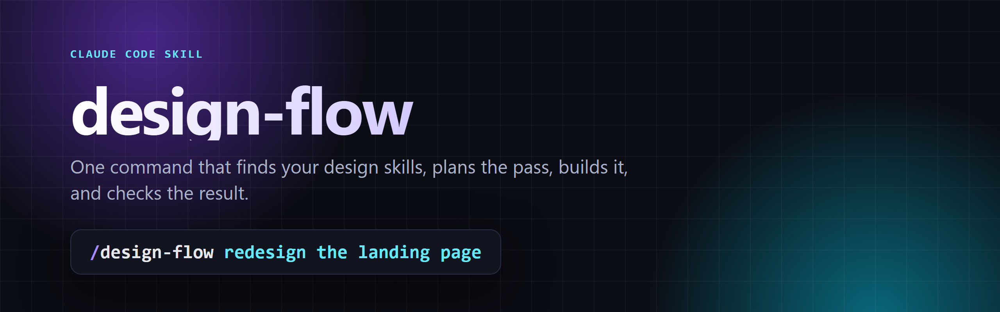

<p align="center">
  
</p>

# Design Flow

**One design workflow. The specialist collection included.**

Design Flow integrates **design-studio-pack** into one installable `design-flow` skill. Describe your goal once; the orchestrator selects relevant specialists, reads their original instructions, and guides the work through direction, implementation, and verification.

Unlike the original discovery-only version, this repository includes the specialists themselves: instructions, scripts, references, datasets, and the declared skill dependency. No separate installation of each upstream skill is necessary.

- **8 requested sources + 1 declared dependency**, pinned to specific commits.
- **169 default selectable workflows** across **201 original skill manifests**.
- **8,476 upstream file entries**, including one materialized symlink, verified against the source lock.
- **One entry point**, with installation targets for Claude Code, Codex, and Antigravity.
- **Offline installation** once downloaded; specialist tools may still require runtimes, accounts, or network access.

> Manifest counts include variants, duplicates, and development fixtures, not 201 independent production skills. See [coverage](skill/design-flow/COVERAGE.md) and the [complete catalog](skill/design-flow/CATALOG.md).

## Quick start

Requires **Python 3.10+**. Use `python3` instead of `python` where appropriate.

```bash
git clone https://github.com/smafnan/design-flow.git
cd design-flow
python install.py --agent claude
```

Choose the appropriate installation target:

```bash
python install.py --agent claude
python install.py --agent codex
python install.py --agent antigravity
```

Each command installs the **same complete pack**. Start a new agent session afterward.

| Host | Default user installation |
|---|---|
| Claude Code | `~/.claude/skills/design-flow` |
| Codex | `~/.agents/skills/design-flow` |
| Antigravity | `~/.gemini/config/skills/design-flow` |

Convenience wrappers are included:

```powershell
.\install.ps1 -Agent codex
```

```bash
sh install.sh --agent claude
```

### Project and custom paths

```bash
python install.py --agent claude --scope project --project /path/to/project
python install.py --agent codex --scope project --project /path/to/project
python install.py --skills-dir /path/to/custom/skills
python install.py --agent codex --dry-run
```

Project installs use `.claude/skills` for Claude Code and `.agents/skills` for Codex and Antigravity. `--skills-dir` specifies the parent directory; the installer adds `design-flow`. The existing `CLAUDE_SKILLS_DIR` environment override is supported for Claude user installs.

## Usage

Claude Code:

```text
/design-flow redesign this landing page while preserving our brand
```

Codex:

```text
$design-flow audit this dashboard for accessibility and responsive behavior
```

For other host interfaces, request the skill explicitly:

```text
Use design-flow to improve these interactions and respect reduced-motion preferences.
```

### What you can do

- Develop visual direction and implement responsive pages and components.
- Review checkout, onboarding, navigation, and other product flows.
- Establish design tokens, typography, spacing, and component consistency.
- Refine empty states, validation messages, loading states, and UX copy.
- Design interactions, transitions, and motion systems.
- Plan or build Remotion product explainers with the required runtime.
- Review accessibility, frontend performance, and framework composition.

The pack supplies instructions and resources, not an autonomous design application. Results depend on the model, project, tools, and checks performed.

## Workflow

| Phase | Responsibility |
|---|---|
| **Understand** | Inspect the request, stack, project instructions, brand, components, and constraints. |
| **Discover** | Search the bundled catalog and load relevant original specialist instructions. |
| **Plan** | Choose one primary direction and a small set of supporting specialists; resolve conflicts against project requirements. |
| **Execute** | Apply guidance while preserving project conventions and requested scope. |
| **Verify** | Run appropriate available checks and inspect visual quality, responsiveness, accessibility, and motion where tools allow. |
| **Report** | Summarize changes, selected specialists, completed checks, and anything unverified. |

Review-only requests remain review-only. Installation does not enable upstream hooks, install framework dependencies, deploy projects, or authorize commits or pushes.

## Included sources

| Source | Main contribution |
|---|---|
| [Impeccable](https://github.com/pbakaus/impeccable) | Interface refinement, visual critique, and design quality workflows. |
| [Taste Skill](https://github.com/Leonxlnx/taste-skill), linked from [tasteskill.dev](https://www.tasteskill.dev/docs) | Visual direction and frontend craft. |
| [UI UX Pro Max](https://github.com/nextlevelbuilder/ui-ux-pro-max-skill) | Searchable design guidance, style resources, and implementation references. |
| [Anthropic frontend-design](https://github.com/anthropics/skills/tree/main/skills/frontend-design) | Distinctive frontend design; only the requested skill subtree, not the entire Anthropic library. |
| [Emil Kowalski's skills](https://github.com/emilkowalski/skills) | Interaction, animation, and interface engineering guidance. |
| [Awesome Motion Design Agent Skills](https://github.com/frankxai/awesome-motion-design-agent-skills) | Motion-oriented workflows and resources. |
| [Vercel Agent Skills](https://github.com/vercel-labs/agent-skills) | Framework, composition, performance, and interface guidance, plus other shipped workflows. |
| [Designer Skills](https://github.com/Owl-Listener/designer-skills) | Product design, research, UX, and design operations workflows. |
| [Remotion Skills](https://github.com/remotion-dev/skills) | The motion collection's declared skill dependency and its shipped resources. |

### Scope and completeness

The pack preserves seven requested repository snapshots, the requested Anthropic `frontend-design` subtree with its notice material, and the declared Remotion dependency snapshot. Original files live under `.upstream`; catalogs provide discovery without replacing originals with summaries.

All **201** discovered `SKILL.md` files are recorded: **169 active**, **22 alternate variants**, **6 duplicates**, and **4 development fixtures**. Default discovery excludes the latter categories, but they are not removed. Supporting resources have their own index.

The scope is **eight sources plus declared skill dependencies**, not every unrelated repository linked in a README. Runtime packages, browsers, paid services, and credentials are not automatically installed. See [dependencies](skill/design-flow/DEPENDENCIES.md) for requirements and the recorded dependency resolution.

## Explore and verify

From the repository root:

```bash
python skill/design-flow/scripts/pack.py search "accessible forms"
python skill/design-flow/scripts/pack.py list --source emil
python skill/design-flow/scripts/pack.py list --all
python skill/design-flow/scripts/pack.py verify
python skill/design-flow/scripts/pack.py doctor
python tools/validate.py
```

Use a search result's ID with `pack.py locate ID` to find its original directories, or `pack.py show ID` to read its instructions. `pack.py run ID -- EXECUTABLE ARGUMENTS` runs an explicitly chosen helper with relocated path placeholders and environment variables; it does not install dependencies. See [portability](skill/design-flow/PORTABILITY.md).

`verify` checks the pinned upstream payload. `validate.py` also checks catalog completeness, manifest hashes, dependency resolution, resource paths, authored Python syntax, and documentation links. `doctor` reports executable availability, not full runtime compatibility.

## Compatibility

| Environment | Support boundary |
|---|---|
| Claude Code | Standard skill folder and explicit invocation; upstream hooks/plugins require separate host-aware setup. |
| Codex | Standard skill folder plus `agents/openai.yaml`; no dependency on Claude's Skill tool. |
| Antigravity | Standard skill files and a targeted installer path; check discovery and execution in your installed version. |
| Gemini CLI / Gemini chat | Not a tested installation target. Antigravity support does not imply Gemini CLI or web-chat integration. |

The Python installer is designed for Windows, macOS, and Linux. Local verification covers the payload and installer behavior; live execution in each host and macOS/Linux installation are not asserted as tested. A host must provide file access and, for scripts, command execution. Tool-specific upstream features may require manual equivalents or remain unavailable.

This is a **single skill-folder distribution**, not a marketplace plugin. Nested specialists are discoverable through the pack; they are not separately registered as hundreds of host commands.

## Upgrade or uninstall

Existing installations are never silently overwritten:

```bash
python install.py --agent claude --replace
python install.py --agent claude --uninstall
```

Use the same agent, scope, and custom path options used at installation. Replacement and uninstall preserve the previous folder under `.design-flow-backups` within the parent skills directory. The exact backup location is printed. Uninstall requires an installation receipt; older/manual installations must be handled explicitly or upgraded with `--replace` first.

Reinstalling does not refresh upstream sources: this pack deliberately uses pinned snapshots.

## Repository layout

```text
design-flow/
  install.py                  Validated installer with recoverable backups
  install.ps1 / install.sh    Convenience wrappers
  sources.json                Source definitions and scope
  requirements-build.txt      Catalog rebuild dependency only
  skill/design-flow/
    SKILL.md                  Single orchestrator entry point
    agents/openai.yaml        Codex discovery metadata
    .upstream/                Preserved source snapshots and resources
    sources.lock.json         Commit pins, hashes, modes, and link metadata
    catalog.json              Manifest inventory and classification
    resources.json            Supporting-resource index
    dependencies.lock.json    Declared skill dependency resolution
    CATALOG.md / COVERAGE.md   Human-readable inventory
    DEPENDENCIES.md            Runtime requirements and boundaries
    PORTABILITY.md            Host and helper execution guidance
    THIRD_PARTY_NOTICES.md     Attribution and license notes
    scripts/pack.py            Discovery and helper CLI
  tools/                      Vendoring, catalog, validation, and ZIP utilities
  docs/MAINTAINING.md          Reproducibility and release workflow
  assets/                     Repository illustrations
```

## Maintenance and offline distribution

Normal installation needs no package downloads. Catalog rebuilds use a separate build requirement:

```bash
python -m pip install -r requirements-build.txt
python tools/build_catalog.py
python tools/validate.py
python tools/package.py
```

Packaging creates `dist/design-flow.zip` and a SHA-256 checksum, validates every archived file, and includes installers and documentation. Extract the archive and run its installer. Build output and local installation state are not source-controlled.

See [MAINTAINING.md](docs/MAINTAINING.md) before updating snapshots or staging vendored files: preserved upstream ignore files can hide required files from a normal `git add`.

## Licensing and attribution

Original Design Flow code and newly authored integration code are covered by the root [MIT license](LICENSE). **That license does not relicense bundled third-party content.** Original notices and license files are preserved, and source commits are recorded in the lock file.

Read [THIRD_PARTY_NOTICES.md](skill/design-flow/THIRD_PARTY_NOTICES.md) before redistributing the full pack. The pinned Vercel and Remotion snapshots do not contain standalone repository license files; per-skill metadata is not a substitute for confirming redistribution rights for every included file. Review those permissions before publishing a public bundled release.
